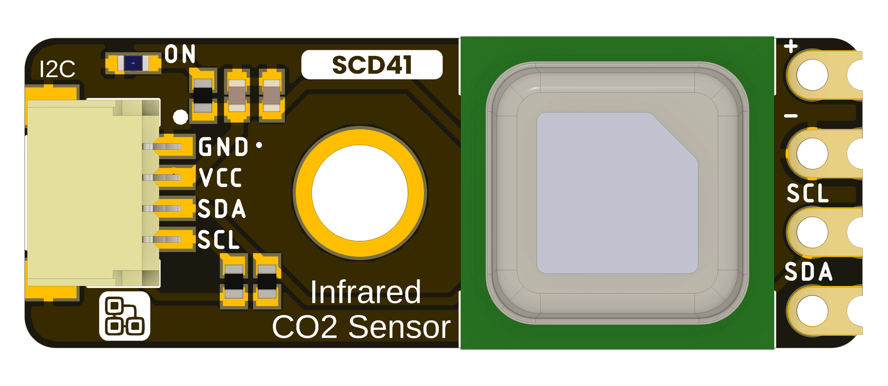

# DevLab I2C SCD41 Air Quality Sensor

**MPN: UE0179**

The DevLab I2C SCD41 Air Quality Sensor is an I2C air quality sensing module in the UNIT Electronics DevLab family.

  
  
<em>DevLab I2C SCD41 Air Quality Sensor</em>

## Overview

| Feature | Description |
|---|---|
| Product | DevLab I2C SCD41 Air Quality Sensor |
| MPN | UE0179 |
| Interface | I2C |
| Available visuals | Product-specific top and bottom board views |

## Resources

- [Hardware files and board views](hardware/README.md)
- [Product reference source](tools/product-reference/README.md)
- [Generic I2C scanner examples](software/README.md)

The supplied source package does not include a product-specific schematic. Check the product-specific pinout or schematic for wiring and electrical limits.

## License

See the [repository license](LICENSE).
