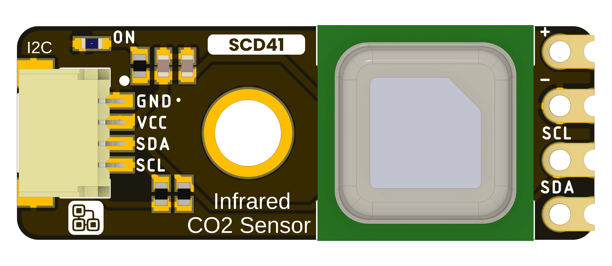
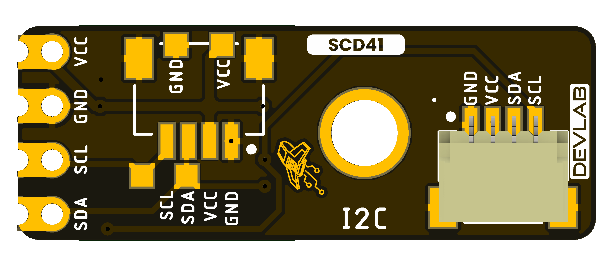

# DevLab I2C SCD41 Air Quality Sensor

MPN: **UE0179**

## Board Views

## Mechanical Drawings

- [Board dimensions](resources/unit_dimensions_v_1_0_ue0179_i2c_scd41_air_quality_sensor.png)
- [Board topology](resources/unit_topology_v_1_0_ue0179_i2c_scd41_air_quality_sensor.png)

## Pinout

- [English pinout](./unit_pinout_v_1_0_ue0179_i2c_scd41_air_quality_sensor_en.pdf)
- [Spanish pinout](./unit_pinout_v_1_0_ue0179_i2c_scd41_air_quality_sensor_es.pdf)

Board renders show the supplied layout. Confirm electrical limits, connector
orientation, and mechanical tolerances against product-specific drawings before
using the board in a final assembly.
