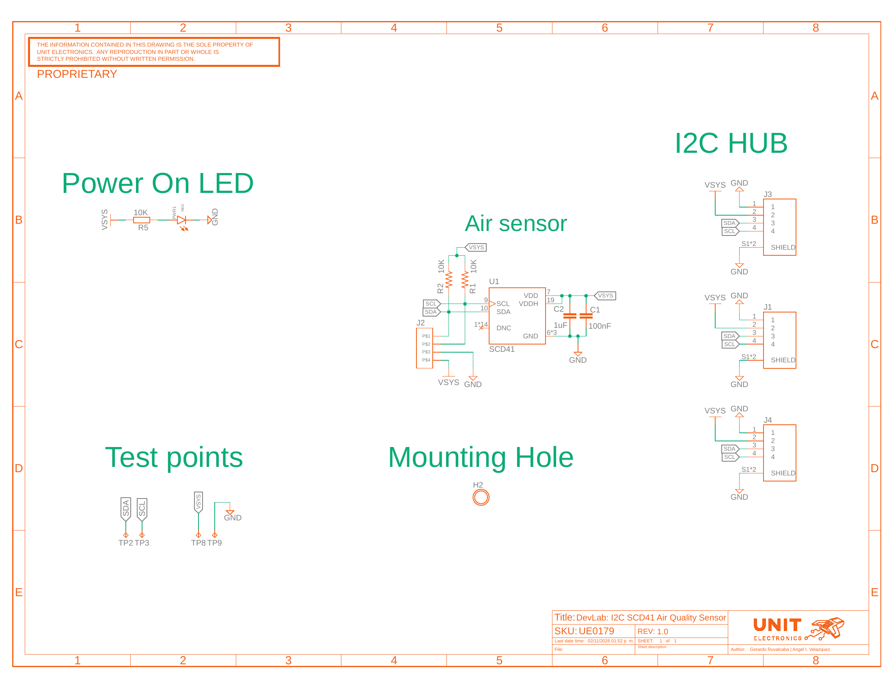

## **9 Appendix**

### **9.1 Schematic Source** {.section-page}

The UE0179 V1.0 board schematic identifies the SCD41 sensor, I2C connectors, pull-ups, supply decoupling, power indicator, and test points.

### **9.2 Document Control**

| Item | Value |
|---|---|
| Product | DevLab I2C SCD41 Air Quality Sensor |
| MPN | UE0179 |
| Source | UNIT Electronics selected product source package |

### **9.3 Data Requiring Confirmation**

Electrical limits, I2C commands, and mechanical tolerances must be verified against product-specific released documentation.

```{=openxml}
<w:p><w:r><w:br w:type="page"/></w:r></w:p>
```

### **9.4 Board Schematic** {.schematic-page}

The UE0179 board schematic shows the complete sensor and connector circuit.

{width=6.4in}
